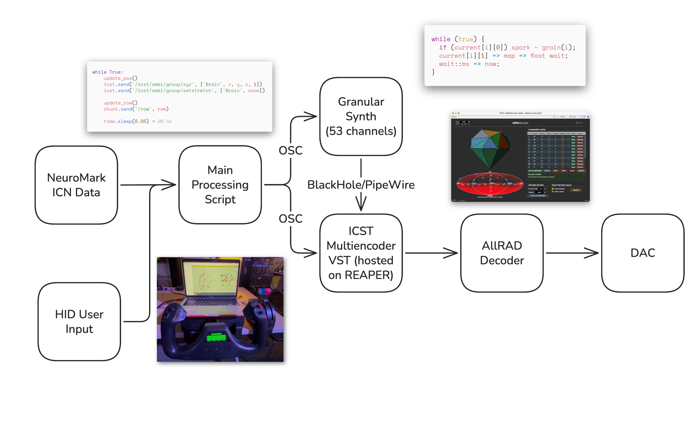

# brain.wav

  
  

**brain.wav turns fMRI data into an immersive sonic scene.** The project has two aims: to give researchers a way of *hearing* differences in brain activity between people with and without schizophrenia, and to explore what happens where spatial audio and sonification meet.

It continues a line of work in the lab that began with [Schizosymphony](/schizosymphony), moving from a fixed composition towards an interactive tool that a scientist could actually sit down and explore.

## Data

The project works with data from **NeuroMark**, an ICA-based pipeline that produces reproducible fMRI markers of brain disorders. Scans are grouped into **53 intrinsic connectivity networks** (ICNs), each of which becomes a sound source in the spatial scene, positioned according to its location in the brain.

## Sonification

Two complementary approaches run over the same data.

**Audification** treats the ICN time series directly as sound: values are normalized and translated into sound pressure samples at 48 kHz. Since one period spans 157 samples, the result sits at roughly 306 Hz — inside the range where the ear hears pitch and timbre rather than rhythm.

**Parameter mapping** sonifies each ICN through a granular synthesizer driven by its own audified data, with the instantaneous value controlling grain rate, grain onset and channel gain. The 53 networks are rendered in third-order Ambisonics, so the anatomical layout of the brain becomes the spatial layout of the sound.

## Sound Design

Alongside the audified material, the team recorded a **corpus of vocal sounds** as an analogy for brain activity — SATB voices across low, mid and high registers, on the vowels a/e/i/o/u, in breathy, raspy and supported timbres. Using the voice keeps the result legible as something biological rather than purely synthetic.

## Interaction

The scene is explored with a HID flight controller, which maps physical axes onto navigation through the data:

- **Ailerons** — pan left and right
- **Elevator** — pan forwards and backwards
- **Left throttle** — pan up and down
- **Mid throttle** — move forwards and backwards through time
- **Right throttle** — zoom in and out

Time is a control axis like any other, so a researcher can hold still and listen, or move through the scan at their own pace.

## Technical Workflow

ICN data and controller input feed a main processing script, which distributes OSC to two paths: a 53-channel granular synthesizer routed through BlackHole/PipeWire, and the ICST Multiencoder VST hosted in Reaper. Both meet at an AllRAD decoder before reaching the loudspeakers.

## Future Work

Work continues on streamlining the workflow, on needfinding and user studies around effective sound design, on extending the approach to other kinds of data such as correlation matrices, and on testing the tool in an actual research setting.

---

brain.wav was led by [Tristan Peng](/people/tristan-peng), with Gabriel Pett, Yan Lin, Attlas Zhang, Manthan Gupta and Noel Park, advised by [Henrik von Coler](/people/henrik-von-coler). The work was carried out through the lab's [VIP team](/courses/vip-sound-space) and [capstone and undergraduate research](/courses/undergrad-research) registrations.
